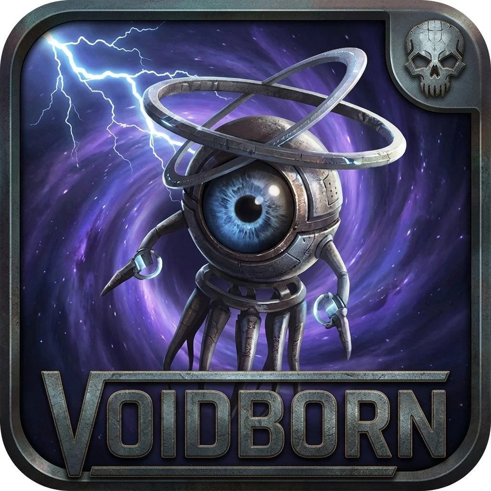
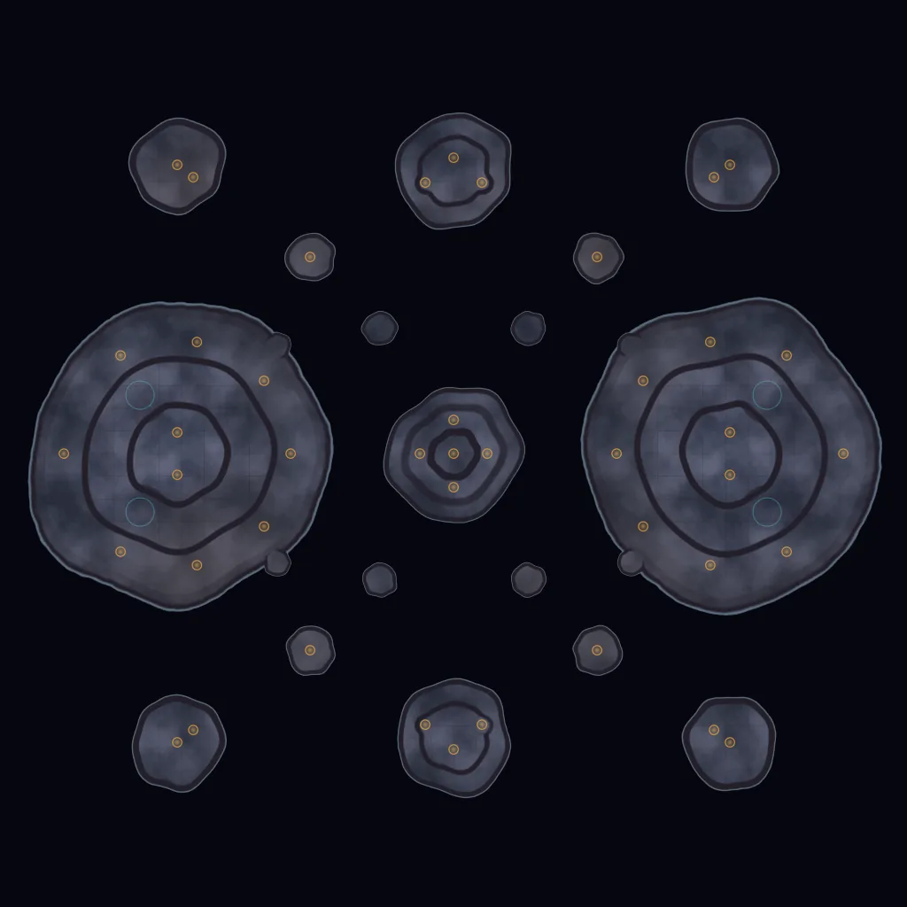

# VOIDBORN
a 3D space RTS for the Spring/Recoil engine and openended unit creation

Two factions of surreal alien monsters fight over floating asteroids in deep space.

* **Choir of the Eye** — pale, many-eyed cyclopes. Long-range lasers, fragile at close quarters.
* **Maw Swarm** — chitinous, toothed, many-legged. Short reach, tougher, regenerating, cheaper.

▶ **In a video**: [VOIDBORN 1.0 — New RTS Game allows you to create endless OP units in-game!](https://www.youtube.com/watch?v=TtKTK60Kb-I) (26 minutes)

What is in the first release, in one list: [docs/release-1.0.md](docs/release-1.0.md).

## Files

| File | Where it goes |
|---|---|
| `voidborn.sdz` | the game → `games/` folder of your BAR / Spring data directory |
| `voidborn_rift.sd7` (+ `.md5.gz`) | the map "Voidborn Rift" → `maps/` folder |
| `Play_Choir_vs_Bot.txt`, `Play_Maw_vs_Bot.txt`, `Watch_Bot_vs_Bot.txt` | start scripts |

## In the lobby

The game carries the pictures a lobby wants, so it shows up with the right art
wherever you find it:

* `game/sidepics/choir.png` and `game/sidepics/maw.png` — the faction emblems,
  named after the factions, so the lobby (SpringLobby, SkyLobby, the TA client)
  and the Coilbox hub pick them up for the two sides. They are 512 × 512 PNGs:
  the older TA client wanted a small BMP, the modern ones take anything.
* `game/bitmaps/loadpictures/voidborn.jpg` (and the PNG beside it) — the loading
  screen. Coilbox reuses it in its game list until the hub has card art of its
  own.
* `tools/gen_sidepics.py` draws all of them, so they stay in the same style as
  the rest of the art.

## How to run it

Voidborn is its own game (not a BAR mod), so you start it with an engine binary and a start script, not from the BAR lobby.

**The easiest way in — [the Voidborn page on the Coilbox hub](https://hub.coilbox.org/games/VB)** — for both single player
and multiplayer: it carries the game, the map, the faction art and the links, and it is where the running servers are
listed. Everything below is what to do if you would rather set it up yourself.

### How to run it directly from Spring

If you have the Spring engine installed (not BAR), you can launch Voidborn directly:

```
spring Voidborn 1.0.sdz Play_Choir_vs_Bot.txt
```

Or from the command line with the Spring binary. The game requires the `voidborn 1.0.sdz` archive in your Spring data `games/` folder (derived from `modinfo.lua name="Voidborn"` + `version="1.0"`).

For a Flatpak install of BAR the data directory is typically under `~/.var/app/info.beyondallreason.bar/` (look for the folder that already contains BAR's own `games/` and `maps/`). Copy the two archives there, then launch that install's `spring` binary with a start script (you may need to run it from a Flatpak shell).

When the game screen loads, press **Enter / the Start button** (you can also place your start spot first).
`Watch_Bot_vs_Bot.txt` starts two bots against each other so you can spectate.

## What "3D" means here

The Spring engine's terrain is a heightfield, so structures must sit on rock. Voidborn gets its third dimension from:

* **Every mobile unit flies.** Layers are real: scouts and raiders hover at 60–95 elmos, assaults ~80–95, snipers/artillery ~150, titans ~210–230. Expansion across the void is done by flying builders.
* **A tiered map** with 3 terrace heights on the home asteroids (285 / 195 / 115), a crater-ring "Eye" in the centre, and floating islands in a true void (no water; skybox with stars/nebula).
* Tall tower structures (Watcher, Pillar of Judgement) give vertical presence.

## Maps

**Voidborn Rift** is the official map: two symmetric home asteroids (west/east, 10 metal spots each), a central
Eye ring (5), north/south islands (3 each), four corner islands (2 each) and floating debris (1 each) &ndash;
43 metal spots in total, 2&ndash;4 players. It is part of the game (`dist/voidborn_rift.sd7`).

Around it is a family of arenas in the [BAR-Maps repository](https://github.com/bitopsy/BAR-Maps): each one
with its own archive, minimap and documentation file. Drop a `.sd7` into the `maps/` folder of your engine data
directory and it shows up in the map list of the game &ndash; no rebuild needed.

<!-- maps: generated by tools/build_readme_maps.py -->

| Map | Preview | Size | Start spots | Mexes | Metal/s | Download | Docs |
|---|---|---|---|---|---|---|---|
| **Voidborn Rift** (official) |  | 5,120 x 5,120 | 4 | 43 | &mdash; | [0.9 MB](https://raw.githubusercontent.com/bitopsy/voidborn/master/dist/voidborn_rift.sd7) | [md](https://github.com/bitopsy/voidborn/blob/master/map/mapinfo.lua) |
| AKUMA |  | 8,192 x 8,192 | 16 | 20 | 720 | [24.4 MB](https://github.com/bitopsy/BAR-Maps/raw/master/AKUMA/AKUMA.sd7) | [md](https://github.com/bitopsy/BAR-Maps/tree/master/AKUMA) |
| Avatar v2 |  | 7,168 x 7,168 | 8 | 48 | 96 | [7.83 MB](https://github.com/bitopsy/BAR-Maps/raw/master/AVATAR/avatar_v2.sd7) | [md](https://github.com/bitopsy/BAR-Maps/tree/master/AVATAR) |
| Minecraft Blockland Overworld v2 |  | 8,192 x 8,192 | 8 | 94 | 188 | [0.82 MB](https://github.com/bitopsy/BAR-Maps/raw/master/BLOCKLAND/minecraft_blockland_overworld_v2.sd7) | [md](https://github.com/bitopsy/BAR-Maps/tree/master/BLOCKLAND) |
| Chess Classical v1 |  | 5,120 x 5,120 | 2 | 25 | 50 | [0.5 MB](https://github.com/bitopsy/BAR-Maps/raw/master/CHESS/chess_classical_v1.sd7) | [md](https://github.com/bitopsy/BAR-Maps/tree/master/CHESS) |
| Paris |  | 8,192 x 8,192 | 20 | 117 | 234 | [21.84 MB](https://github.com/bitopsy/BAR-Maps/raw/master/PARIS/paris.sd7) | [md](https://github.com/bitopsy/BAR-Maps/tree/master/PARIS) |
| Planet Earth |  | 12,288 x 6,144 | 16 | 193 | 579 | [23.08 MB](https://github.com/bitopsy/BAR-Maps/raw/master/planet_earth/planet_earth_v1.sd7) | [md](https://github.com/bitopsy/BAR-Maps/tree/master/planet_earth) |
| Planet Mars |  | 8,192 x 8,192 | 8 | 77 | 232 | [22.89 MB](https://github.com/bitopsy/BAR-Maps/raw/master/planet_mars/planet_mars.sd7) | [md](https://github.com/bitopsy/BAR-Maps/tree/master/planet_mars) |
| Cosmic Spaceship |  | 5,120 x 5,120 | 8 | 17 | 58 | [5.16 MB](https://github.com/bitopsy/BAR-Maps/raw/master/SPACESHIP/cosmic_spaceship_v1.sd7) | [md](https://github.com/bitopsy/BAR-Maps/tree/master/SPACESHIP) |
| USA |  | 10,240 x 6,144 | 16 | 160 | 320 | [18.55 MB](https://github.com/bitopsy/BAR-Maps/raw/master/USA/usa.sd7) | [md](https://github.com/bitopsy/BAR-Maps/tree/master/USA) |
| Yin-Yang |  | 4,096 x 4,096 | 2 | 4 | 109 | [3.94 MB](https://github.com/bitopsy/BAR-Maps/raw/master/yin-yang/yin-yang.sd7) | [md](https://github.com/bitopsy/BAR-Maps/tree/master/yin-yang) |

The numbers come out of the map archives themselves (`tools/collect_map_stats.py` reads them with
`bar_map_stats.py`), so they describe what is really in the map. The website has the same list with the full
description of every map: <https://f33.fr/vb/maps.html>

## Units

### Choir of the Eye

| Unit | Role | Metal | HP | Altitude | Weapon (range) |
|---|---|---|---|---|---|
| Hierophant | Cyclopean Commander | 2500 | 4200 | 45 | Gaze (430), Cataract Stare (240) |
| Seer | Builder | 90 | 520 | 50 | — |
| Gazer | Scout | 38 | 230 | 95 | Pinprick (270) |
| Lashling | Raider | 55 | 330 | 65 | Lash Pulse (215) |
| Cyclops Hoplite | Assault | 195 | 1400 | 95 | Cyclops Gaze (380) |
| Basilisk | Long range | 250 | 560 | 150 | Petrifying Beam (740) |
| Weeper | Support | 150 | 700 | 105 | — |
| Argus Colossus | Heavy | 1650 | 9500 | 230 | Annihilating Gaze (650), Lesser Eyes (380) |

Structures: **Iris Womb** (factory), **Leech Eye** (metal extractor), **Sun Iris** (energy), **Singularity Heart** (advanced energy), **Tear Vault** (storage), **Watcher** (radar), **Stare Stalk** (light defence), **Pillar of Judgement** (heavy defence)

### Maw Swarm

| Unit | Role | Metal | HP | Altitude | Weapon (range) |
|---|---|---|---|---|---|
| Matriarch | Maw Commander | 2500 | 4400 | 45 | Acid Spit (420), Devour (240) |
| Weaver | Builder | 90 | 560 | 50 | — |
| Skitter | Scout | 32 | 240 | 90 | Acid Dart (235) |
| Gnasher | Raider | 52 | 560 | 60 | Maw Breath (130) |
| Ravager | Assault | 160 | 2100 | 80 | Corrosive Bolt (345) |
| Spitter | Artillery | 205 | 600 | 140 | Spores (820) |
| Nurse | Support | 150 | 760 | 100 | — |
| Leviathan | Heavy | 1450 | 13000 | 210 | Acid Cannon (620), Spore Barrage (520) |

Structures: **Brood Hive** (factory), **Root Drill** (metal extractor), **Sunbloom** (energy), **Heartfire Egg** (advanced energy), **Gut Cyst** (storage), **Listening Maw** (radar), **Tooth Spire** (light defence), **Maw Bastion** (heavy defence)

## Dev console & custom units

Open the console with the key left of `1` (``` ` ``` on QWERTY, `²` on AZERTY) or `/vbconsole`. Works in single-player games (the shipped start scripts) or with `/cheat` on.

Spring cannot register new unit *types* while a game runs, so `/vbcreate` clones any existing unit and overrides what you like on the spawned units. Recipes are remembered as templates (saved between games).

```
/vbcreate dread base=ch_hoplite name="Dread Lord" hp=6000 dmg=2.5 range=1.4 reload=0.6 count=3
/vbcreate mw_leviathan speed=2 hp=50000          (bare unit name = base)
/vbspawn dread 5            spawn more from a template, at the mouse cursor
/vbtemplates   /vbforget dread   /vbbases (list base unit names)
/vbexec vb.create{ id="x", base="mw_nurse", hp=99, lua="Spring.Echo(unitID)" }
```

Options: `name hp metal energy buildtime sight alt count team x z png pngsize shape fire move repeat`, and multipliers `speed range dmg reload`. `lua=` (last option) runs on every spawned unit with `unitID` set. `png=` floats an image above each spawned unit (a bare name means `unitpics/<name>.png`; `png=icons/x.png` is used as given, `pngsize=` is in elmos). Put the file in `game/unitpics/` or loose in `<data dir>/unitpics/` (no rebuild needed). `shape=` gives the unit a **new 3D body** (see the unit forge below). `fire=`, `move=` and `repeat=` set the starting stance. Units appear at the mouse cursor unless `x=`/`z=` are given. Results are echoed in the chat log.

The console autocompletes: type `/vbcre` and press `TAB` for `/vbcreate`, `base=ch_` and `TAB` for a unit name, and the whole line is syntax highlighted. The **unit forge** (`/vbforge`) is the graphical version of all of this.

### The price of a custom unit

A unit that is stronger than its base unit is not free. Every custom unit gets a price and a build time, worked out automatically from the changes you made:

| change | what it costs |
|---|---|
| `hp` | the extra hit points cost what the hit points they replace cost |
| `speed` `range` `dmg` | a share of the metal cost of the base unit per multiplier point (0.6 / 0.8 / 1.2) |
| `reload` | twice the share per point, and only for a *faster* reload |
| `sight` | the extra sight radius costs what the base sight radius costs |
| `alt` | energy, per elmo of extra altitude |
| `shape` | a share of the metal cost per primitive of the custom body |
| `lua` | a share of the metal cost for a custom script |
| `count` | every unit of the group is built and paid for on its own |

The premium also adds **build points**: the unit takes `(1 + 0.6 x premium / base metal)` times as long to build (capped at 9x). The rules are in `game/LuaRules/Headers/vb_cost.h.lua` and are used by both the gadget (which puts the price on the unit) and the forge panel (which shows it while you design), so the two always agree. The chat log repeats the price of every unit that is created.

The build panel has a **`[+]` tile at the end of the build row** (right after the commander): click it and the unit forge opens, ready to design a new unit.

## Tier 2 (factory upgrade, T2 units, unit forge)

Select your tier 1 factory (Iris Womb / Brood Hive) and press **Upgrade T2** in the build panel. The team pays **2000 metal + 2800 energy** over 45 seconds (it stalls when the resources run out; pressing the button again cancels and refunds). The factory stops producing meanwhile, then turns in place into the **Great Iris Womb / Great Brood Hive** (same spot, same health fraction, the production queue moves with it). A factory that is destroyed during the upgrade loses what was paid. The numbers live in `tools/gen_defs.py` (`UPGRADE_*`).

The tier 2 factory builds everything tier 1 does **plus the T2 roster**:

| Choir | Role | Metal | HP | Weapons (range) |
|---|---|---|---|---|
| Saccade | Raider | 140 | 620 | Saccade Pulse (285, burst of 2) |
| Sclera Knight | Assault | 520 | 4200 | Knight Gaze (430), Lash Volley (330) |
| Lidless Lance | Artillery | 640 | 1100 | Lance Beam (1150) |
| Lachryma | Support (fast builder) | 380 | 1800 | - |
| Panopticon | Heavy | 4200 | 34000 | Verdict (800), Hundred Eyes (480) |

| Maw | Role | Metal | HP | Weapons (range) |
|---|---|---|---|---|
| Shearwing | Raider | 130 | 1100 | Flaying breath (150) |
| Warmaw | Assault | 480 | 5200 | Siege Bolt (400), Spore Pod (380) |
| Rupturer | Artillery | 620 | 1300 | Bile Salvo (1180) |
| Midwife | Support (fast builder) | 360 | 2000 | - |
| Devourer | Heavy | 3900 | 46000 | Maw Cannon (700), Brood Barrage (600) |

**The unit forge needs a finished T2 factory.** Until then the `[+]` tile and the saved designs are greyed out; hovering `[+]` says to upgrade to a Tier 2 factory first (and shows the upgrade progress). Losing the last T2 factory locks the forge again. It is enforced in the game rules, not only in the UI (production queue and `/vbcreate`). Cheats (`/cheat`) and the lobby option *Unit forge needs a Tier 2 factory* (`vb_forge_needs_t2`) lift the lock. T2 units use their own `customParams.kind` (`raider2`, `assault2`, `art2`, `support2`, `heavy2`, `fac2`), so the bot, which only upgrades nothing, keeps using tier 1.

## Sound

Every sound is generated by `tools/gen_sounds.py` (no samples, no licensing) into `game/sounds/`; `tools/add_sounds.py` wires them into the unit and weapon defs (rerun it if you regenerate defs with `tools/gen_defs.py`). Sound items live in `game/gamedata/sounds.lua`.

* Units: select / acknowledge voices per faction, "can't" buzz, builder zaps, structure activate / deactivate sounds, commander under-attack alarm.
* Weapons: a different shot and impact sound for light / medium / heavy lasers, acid spit, spore missiles, maw flame and the commanders' super weapon; three explosion sizes.
* UI: hover, click, build-select, open / close. Game events (`vb_sounds` widget): start jingle, structure placed, unit ready, structure finished, commander alarm, looping space ambience.
* `/vbsound on|off`, `/vbsound vol 0-100`, `/vbsound ambient on|off`.

## Experience, growth and splitting

`game/LuaRules/Gadgets/vb_experience.lua`: mobile non-commander units grow as they gain experience, up to **2x** their size at `xp = 0.14`. At 0.14 the unit **splits in two**: both halves are normal sized, keep the same health fraction, orders, stances, group and every `/vbcreate` modification (`png`, `name`, `hp`, `speed`, `shape`, ...; a `lua=` snippet is not re-run), and both start again at experience 0. Commanders and structures never split, and a team that is nearly at its unit cap does not split.

**Both numbers are editable by the host (or by anyone in a single player game):**

| | where | default | meaning |
|---|---|---|---|
| `split_xp` | `/vbsettings` panel, or the `split_xp` mod option | `0.14` | the experience at which a unit splits |
| `max_growth` | `/vbsettings` panel, or the `max_growth` mod option | `1.00` | how much bigger it gets first (`1.00` = double size) |

The `/vbsettings` panel is draggable and resizable like the other panels. It shows the values the game is really using; the sliders edit the pending values and `APPLY` sends them to the gadget, which re-scales the units that already grew. The host can also set the numbers in the lobby before the game starts (mod options).

To test quickly: `/vbcreate scout base=mw_skitter lua=Spring.SetUnitExperience(unitID,0.135)` and let it fight.

## Gray matter and mushrooms

`game/LuaRules/Gadgets/vb_mushrooms.lua` + `game/features/vb_graymatter.lua`: when a finished unit dies, its model **shrinks into a lump of gray matter** (about 1.8 s), and the lump leaves a reclaimable feature behind. Left alone, the gray matter **sprouts 3D mushrooms** in random directions (upward from the ground, in all directions when it floats in the void): eight looks (two domes, two bells, a parasol, a morel, a stinkhorn and a cluster), 3 to 9 per patch depending on the size of the unit, each starting to sprout at its own point of the growth curve. They are generated in code (no model files), with pulsing glow spots on the rims and tips.

**The mushrooms are energy.** Builders that can reclaim (Nurse, Weeper, ...) eat them like any feature and the energy goes to their team. A patch holds `seed + (max - seed) * tanh(t / T)` energy after `t` seconds of being left alone, where `max` is the **max health of the dead unit divided by 15** (a 1500 health unit grows up to 100 energy) and `seed` a fifth of that: it grows quickly at first, flattens out, and **never passes the cap** (size follows the same curve, with a hard ceiling of 220 elmos on top). Reclaiming takes energy and size away, and the curve continues from what is left, so a half-eaten patch regrows. Reclaiming is not instant: a Nurse or Weeper takes about **50 energy per second** (`RECLAIM_E_PER_SEC` in the gadget; faster reclaimers and several at once take proportionally more), a **progress bar with the live E/s** shows over a patch while it is eaten, and hovering a patch shows how much energy it holds (`LuaUI/Widgets/vb_mushroom_hover.lua`, which also issues the reclaim order on right-click if the engine did not pick the patch itself). Units that are reclaimed or were still being built leave nothing; set `customParams.nomushroom` on a unit to exclude it.

| mod option | default | meaning |
|---|---|---|
| `mush_enabled` | on | dead units grow mushrooms |
| `mush_grow_secs` | `150` | `T`: 76% grown after `T` seconds, 96% after `2T` |
| `mush_health_div` | `15` | max energy = the dead unit's max health / this |

The other numbers (`SEED_FRAC`, `MAX_FUNGI` = 250 patches, `RECLAIM_PER_E`, ...) are at the top of the gadget.

### Area reclaim (`/vbareclaim`)

`game/LuaUI/Widgets/vb_area_reclaim.lua` takes over an **area reclaim** (the reclaim command dragged as a circle): it finds every reclaimable feature in the circle (mushrooms, rocks, wrecks) and gives each selected reclaimer a queue of single reclaim orders along a **nearest-neighbour path**: the closest one first, then always the closest to where it just was, up to 120 targets. The original area command is queued last, so anything the lookup could not see (units, targets beyond the limit) is still handled by the engine. Shift keeps the builder's current queue; ctrl/alt/meta modes and single-target reclaims are left to the engine. `/vbareclaim` switches it off and on (remembered).

## Unit forge (`/vbforge`)

`game/LuaUI/Widgets/vb_forge.lua` widget: the unit creation panel. Drag the title bar to move it, drag the corner handle to resize it, `/vbforge` opens and closes it.

Four tabs:

* **BASE** - pick the unit to build on (every buildable unit, with its stats).
* **NUMBERS** - sliders for health, metal, energy, build time, sight, speed, range, damage, reload, altitude, count and team, plus toggle buttons for the starting stance (fire state, move state, repeat).
* **IMAGE** - pick one of the PNGs in `unitpics/` (or `icons/`); it is shown above the unit and can be mapped onto the 3D shape.
* **SHAPE** - build a **new 3D body** out of primitives (box, sphere, cylinder, cone). Per primitive: size, position, rotation, colour, which PNG is mapped onto it and the part of that PNG (the UV rectangle). A live 3D preview shows the result.

`CREATE` sends the design to the gadget, `SAVE` stores it as a template and `LOAD` reads a template back. The footer shows what the unit will cost (the same price the gadget charges). The forge and the console share one template store, so a unit built in the panel can be stamped out again with `/vbspawn <id>` and a recipe typed with `/vbcreate` shows up in the panel.

`game/LuaUI/Widgets/vb_shape3d.lua` widget: draws the custom body of every unit that has one (the shape travels in the unit's `vb_shape` rules parameter), with the PNG mapped onto it.

`game/LuaUI/Headers/vb_forge.h.lua` holds the shared parts: the template store, the shape codec, the mesh builders and the PNG list. The shape of a unit is a string, e.g.

```
box@40,30,50@0,15,0@0,0,0@0.8,0.7,0.6,1@0@0,0,1,1
```

(`kind@size@position@rotation@colour@texture@uv`, several primitives separated by `;`), so `/vbcreate x base=ch_hoplite shape="box@40,30,50@0,15,0@0,0,0@1,1,1,1@0@0,0,1,1"` works from the chat too.


## Statistics dashboard (`/vbdash`, Ctrl+Shift+D)

A dark dashboard of graphs and radar charts, live during the game and as the match report at the end (it replaces the engine's end screen).

* **Menu bar** (top centre, always there): STATS, SETTINGS, KEYS, ABOUT buttons and the number of players (humans / bots, how many are alive). `/vbdash menu` hides or shows it.
* **HUD** (top right, draggable, foldable): a live leaderboard (rank, score, army value, metal / energy income), a combat / economy radar (click it to switch), the player count. `OPEN` or Ctrl+Shift+D opens the full dashboard.
* **Leaderboard score**: army value + defence value + economy value + 1.5 x enemy value destroyed + 0.05 x damage dealt + 0.2 x metal produced - 0.25 x value lost.
* **Fog of war**: you see your own side exactly. A hidden enemy is scored only from the units you have actually seen (shown with `~`), and `?` means not scouted yet. Spectators, cheat mode and the end of the game show everything. The `stats_visibility` mod option (`fog` by default, or `all`) sets this. It is an interface rule: every client simulates the whole game.
* **Pages**: OVERVIEW (scoreboard, two radars, share donuts, four graphs), GRAPHS (any statistic as one big graph with event markers), ECONOMY, COMBAT, ARMY, REPORT (victory / defeat banner, awards, final figures), and SETTINGS (menu bar, HUD, interface size, shortcuts to the game's other tools, this match's mod options), KEYS (all hotkeys, read from the live hotkey widget) and ABOUT (the game explained).
* **Clickable**: team cards (hide / show, right click = only this team), table headers (sort), small graphs (open big), the timeline and the big graph (pick a moment), events (jump), unit-type buttons. Keys: Esc, 1-9, left / right, Home, End, mouse wheel (zoom the time axis). `/vbdash [open|close|hud|menu|tab <name>|scale <n>]`.
* **Numbers**: `game/LuaRules/Gadgets/vb_stats.lua` measures every team every 5 seconds (damage without overkill, kills and losses by metal value, metal and energy flow, army / defence / economy value, build power, unit mix, per-unit-type damage and kills). The widget is `LuaUI/Widgets/vb_dashboard.lua`, with its data and drawing code in `LuaUI/Headers/vb_stats_*.h.lua`. A new statistic is one line in the gadget plus one line in the `METRICS` table.
* The old *FFA Timeseries HUD* widget is now off by default (the new HUD covers it; F11 turns it back on).
* Test without the engine: `python3 tools/test_stats.py` (part of the build) and `python3 tools/render_dashboard.py OUTDIR [teams] [minutes] [WxH]` (renders every page to PNG on a mock engine).

## Unit census (`/vbstats`)

`game/LuaUI/Widgets/vb_unitstats.lua` widget: tracks every unit and shows totals (units, mobile / structures, health, metal value, average / max experience, splits so far), distributions (histograms) of health, speed, range, damage/s, experience and size, the unit types present, and the units closest to splitting.

Values are the live ones. Drag the title bar; click the scope tag to cycle MINE / ALLIES / ALL VISIBLE.

## UI

Hovering a build icon shows a hexagonal stats panel (metal, energy, build time, health, speed, sight, range, damage, DPS, reload, economy values) next to the build panel, with a six-axis radar profile (HP, speed, sight, range, DPS, cost; each axis scaled against the strongest Voidborn unit, square-root scale). Saved forge designs get the same panel, computed from the design's own numbers and price.

The engine's stock build panel is hidden; the Lua widget `game/LuaUI/Widgets/vb_buildpanel.lua` is the only build menu. Widget text uses the generated `game/fonts/VoidbornGlyph.ttf` (`python3 tools/gen_font.py` rebuilds it).

## Tested vs. not tested

I ran the game in the Recoil 2026.07.04 headless engine with two bots playing 20–30 minutes of game time: asteroids loaded, commanders spawned, builders built, mexes produced metal, factories produced units, armies fought, bases died, commander death ended the game. I also fixed the bugs that run exposed (builder/factory scripts, weapon loading, mex yield).

**Not tested (no GPU here):** how the models, textures, skybox, explosions and UI actually *look and feel* on screen, sounds (there are none), and human-driven play. Models/textures are generated procedurally (previews in the PNGs), so expect a "first pass" look.

Known simplifications: no sounds; unit icons use the engine default; the bot is simple; balance is a first pass (Choir is slightly stronger vs the bot).

## Regenerating / modding

`voidborn_source.zip` has the generators (Python: models, textures, unit/weapon defs, map) and the game folder. `python3 tools/gen_assets.py && python3 tools/gen_defs.py` rebuild the models and all unit/weapon/script files.

## Multiplayer & Community

* **SkyLobby**: https://github.com/skynet-gh/skylobby/releases/latest — the lobby client for Spring engine games (it is the successor to SpringLobby). Download the installer for your platform there, then use it to find and join multiplayer games of Voidborn. The manual is at https://github.com/skynet-gh/skylobby/wiki/User-Guide. Host your own server to keep a persistent 24/7 Voidborn world running.
* **Coilbox hub**: https://hub.coilbox.org/games/VB — The game's page on the hub: the game itself, the two factions with their art, the unit encyclopedia and the running servers. **Start here, for single player and for multiplayer alike** — it is the shortest path to a match.
* **Discord**: https://discord.com/channels/1481771055063502925 — Join the Voidborn community to find games, discuss strategies, and coordinate with other players.
* **Website**: https://f33.fr/vb/ — Official Voidborn website with downloads, changelog, and community posts. It has a page per subject: [Play](https://f33.fr/vb/play.html), [Maps](https://f33.fr/vb/maps.html), the [Unit Forge](https://f33.fr/vb/forge.html) (how a custom unit is designed, what it costs and how it grows and splits) and the [Roadmap](https://f33.fr/vb/roadmap.html).

We are looking for volunteer 24/7 hosts to keep a persistent Voidborn server running. If you have a server that can run the Spring engine 24/7, please join the Discord and let us know! Help grow the multiplayer community.

## Roadmap

What is being worked on now (the same list is on the website: <https://f33.fr/vb/roadmap.html>):

| Project | State | What it means |
|---|---|---|
| **Custom unit balancing and taxation** | in development | the forge prices a custom unit by what you changed; the balance pass over the whole roster is next, so a design nobody plays against is not worth making and one that beats the game is taxed hard |
| **Factory upgrade from T1 to T2** | in development | a factory that can be upgraded into its second tier: bigger, more expensive, with a build time of its own and a production line that can be switched over |
| **Unit experience evolution and upgrade, with proliferation control** | in development | units already grow and split; evolution takes that further into a next form, and proliferation control keeps the number of units and the metal in the map in check |
| **A third faction** | planned | its own shape, units, economy and art, plus the balance that makes three different ways to play worth playing &ndash; the biggest single piece of work |
| **Hosting games and replays** | planned | a persistent world, a list of the matches running on it and a replay archive that keeps the good games |
| **Steam** | looking for help | a bigger audience needs distributors: streamers, youtubers and curators who think a game about creating your own OP units is worth talking about. Join the [Discord](https://discord.com/channels/1481771055063502925/) and say so |

The game in a video: [VOIDBORN 1.0 &ndash; New RTS Game allows you to create endless OP units in-game!](https://www.youtube.com/watch?v=TtKTK60Kb-I) (26 minutes).

## Production queue (stock units and forge designs)

* The build panel always lists every mobile unit your factories can build (no selection needed); the title bar shows the panel version (`q3`). Clicking one queues it at the selected factory, or at the first factory that can build it.
* Select a factory (hive / womb) and click a mobile unit tile: the unit goes into that factory's own line. Every factory builds in parallel, each line shows a pie chart and `xN` on the tile. Middle-click = hold, right-click = take one out (shift = 5, ctrl+right = cancel the line and refund). Structures still use the engine's normal placement.
* A factory that is **still being built** cannot make anything yet: the unit stays in the queue and waits for it. The tile shows a cyan clock (state `p`), the hover text says `PENDING: the factory is still being built`, and nothing is paid for the unit until the factory is finished. So you can order a unit from a hive that is still under construction and it starts building the moment the hive is done. The build panel prefers a factory that is finished when it picks one for you.
* Forge designs share one team line and appear at your start position. Hover a design tile and click the red **x** (or ctrl+right-click) to delete it.
* `buildTime` is in build points. The queue builds at `BUILD_POWER = 100` points per second (`game/LuaRules/Headers/vb_cost.h.lua`), the same as a factory with workerTime 100.
* Modoption `vb_forge` (default on) lets every player use the forge in a real match; forge units are paid for in the queue and `lua=` is only honoured with cheats or a single human. The free `/vbcreate` console stays cheat-gated.
* `python3 tools/test_queue.py` and `python3 tools/test_buildpanel.py` run the queue and the panel against a mock engine (`tools/test_healthbars.py` does the same for the health bars) (needs `pip install lupa`).

## Repository layout

Everything the game contains lives in `game/` — that is the folder `build_sdz.py` zips into `voidborn.sdz`. The old copies of those folders at the repo root are gone; there is one copy of everything.

```
game/                 the game itself (this is what ships)
  LuaRules/           the game logic
    Gadgets/          one file per feature (queue, forge, experience, icons, ...)
    Headers/          shared rules used by more than one gadget
  LuaUI/              the interface
    Widgets/          one file per widget (build panel, forge, health bars, ...)
    Headers/          shared helpers for the widgets
  units/ weapons/     the unit and weapon definitions
  gamedata/ scripts/  unit scripts, sounds, icon types
  icons/ unitpics/    the role icons and the unit pictures
  modinfo.lua modoptions.lua   the game description and the lobby options
  luaui.lua luaai.lua          the interface and AI entry points
  vb_build.txt        the build stamp (written by build_sdz.py, shown by the build panel)
tools/                the generators (models, textures, defs, icons, map) and the smoke tests
map/                  the map source
dist/                 the build output: voidborn.sdz, voidborn_rift.sd7
out/                  generated images that are not part of the game
vb/                   the website (index, play, maps, forge; all local, no external requests)
docs/                 notes
```

`build_sdz.py` (repo root) is the one command that builds and installs; `install_and_build.py` unpacks a source zip over the repo first.

## Building and installing (`build_sdz.py`)

`python3 build_sdz.py` is the one command that builds the game and proves that the engine will run it (`pip install lupa` first). It stops with exit code 1 at the first failed step:

1. every Lua file in `game/` must compile (Lua 5.1, as in the engine)
2. the smoke tests `tools/test_*.py` must pass
3. `dist/voidborn.sdz` is built, with a build stamp `<date-time>-<content hash>` in `vb_build.txt`
4. the archive is re-opened and compared with `game/` file by file (names, sha256, CRCs, `modinfo.lua` at the root, Lua syntax of the archived copy)
5. it is copied atomically to `~/.spring/games/voidborn.sdz` (`--games-dir` or `SPRING_GAMES_DIR` to change it) and the copy is compared with the build; other archives of the same game in that folder are renamed `*.disabled-<stamp>` so that they cannot shadow it (copies in other data folders are reported)
6. `spring-headless` runs `Watch_Bot_vs_Bot.txt` and its log must contain `[VB] build <stamp>` (logged by `game/LuaRules/Gadgets/vb_buildinfo.lua` from the archive the engine really mounted). Without a headless engine the step is reported as NOT verified (`--engine PATH`, `--strict-engine`, `--no-engine-check`)

In game, the title bar of the build panel ends with the same stamp. Options: `--no-install`, `--no-tests`, `--keep-others`.

### Releasing (`.github/workflows/release.yml`)

Pushing a `v1.0.0` tag (or creating a release) builds both archives on the runner
and attaches them to the release: `voidborn-<tag>.sdz` and
`voidborn-map-<tag>.sd7`. It runs the same build as here (`build_sdz.py`,
`tools/build_map.py`, `tools/gen_skybox.py`) and only skips the install and the
engine check, because a runner has neither an engine nor a games folder. The
workflow refuses to build anything that is not shaped like `X.Y.Z`.

The map is generated from `map/mapinfo.lua` and the height map the generator
makes (`tools/build_map.py`, about 20 seconds), together with the skybox the
map asks for (`tools/gen_skybox.py`, a DDS cubemap with a nebula and stars).

Everything the game contains lives in `game/` (that folder is what `build_sdz.py` zips). The old copies of those folders at the repo root were removed. `tools/` holds the generators (paths are relative to the repo), `map/` the map source, `dist/` the build output.

## Health bars

`game/LuaUI/Widgets/vb_healthbars.lua` draws a bar above every selected unit (mode *always*: every visible unit): green to red for your units and allies, a red bar for enemies, and a second blue bar for the build progress of an unfinished structure. By default bars show **only on selected units** (and the build progress of selected unfinished structures); `/vbhealth` cycles *selected* / *always* / *damaged* (and selected) / *off*; the choice is remembered. Structure tiles of the build panel show a pie with the build progress of the most advanced one under construction (blue pie = a builder is working on it, `xN` = how many are being built).

### Zoomed-out icons

Every unit shows a **role icon** when the camera is far out. The icons are shared by both factions: one per role (commander, builder, scout, raider, assault, artillery, support, heavy, factory, metal extractor, energy, advanced energy, storage, radar, light defence, heavy defence), white glyphs that the engine tints with the team colour. Forge designs use the icon of their base unit. `tools/gen_icons.py` draws them (`game/icons/vb_<role>.png`) and writes `game/gamedata/icontypes.lua`; `tools/gen_defs.py` sets `iconType = "vb_<role>"` on every unit def, and `tools/test_icons.py` checks the wiring. How far out the camera must be before units turn into icons is the engine's own setting (`/disticon <n>`).

### Sensor ranges (`/vbranges`)

`game/LuaUI/Widgets/vb_ranges.lua` draws the **line of sight (green)** and **radar (blue)** circles on the ground for the selected units, using the live values (forge designs with extra sight, radars that are switched off). While you are placing a structure, its ranges are shown at the mouse. The circles are drawn **half as opaque while any unit is selected**. `/vbranges` cycles *selected* / *all your units* / *off*; the choice is remembered.
